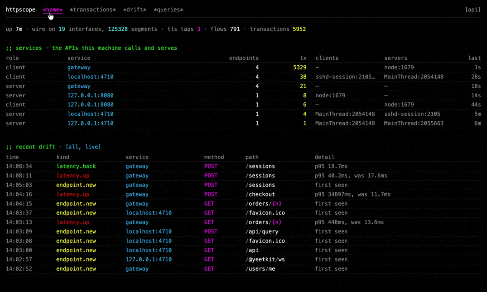

# `httpscope`

> The API docs nobody wrote, read off the wire, with a note every time the API stops matching them.

<p align="center">
  <a href="#requirements"></a>
  <a href="https://yeet.cx/docs/?utm_source=github&utm_medium=readme&utm_campaign=httpscope&utm_content=badge"></a>
  <a href="#what-youre-looking-at"></a>
  <a href="https://discord.gg/JxVseaAVAU"></a>
</p>

<p align="center"></p>

**`httpscope` is an eBPF API drift detector for Linux: it learns the shape of every HTTP API a machine serves and calls from live traffic, TLS included, and flags the moment one changes.**

## Quick start

```sh
curl -fsSL https://yeet.cx | sh                                    # yeet, once
curl -fsSL https://deb.nodesource.com/setup_24.x | sudo bash -     # Node 24 (Debian, Ubuntu)
sudo apt install -y nodejs
git clone https://github.com/yeet-src/yeetkit && (cd yeetkit && npm install)
git clone https://github.com/yeet-src/httpscope && cd httpscope
npm install && make bpf && npm run dev                             # http://localhost:3000
```

Start it on a server and within a minute you have a table of every HTTP API the machine serves and every API it calls, which process is on each end, every endpoint with its status codes and p50/p95 latency, and the JSON shape of each request and response, learned from real bodies. Then it keeps watching. When a field that was in every response stops arriving, a number turns into a string, an endpoint starts answering 500, or its p95 doubles, that lands in the drift feed with the endpoint and the detail. A dashboard of request counts doesn't show that kind of change.

People read it as six pages in a browser. Agents read one page at `/api` and then ask in GraphQL, the same query language as yeet's system graph.

> [!TIP]
> Plaintext comes off the wire: a TCX program on every network interface, `lo` included, copies each TCP segment and `httpscope` puts the streams back together. HTTPS comes from inside the TLS library: uprobes on OpenSSL's `SSL_read`/`SSL_write` (and the `_ex` pair) and rustls read the request and response before encryption and after decryption. They attach to the library file, not a process, so one attach covers every process that maps it, including a `curl` that lives for 50 ms. No proxy, no sidecar, no certificate, no change to the app.

## Have an agent set it up

Paste this into Claude Code, Codex or Cursor on the Linux machine:

```text
Set up httpscope (https://github.com/yeet-src/httpscope) on this machine and show me the HTTP APIs it sees.
1. Check `uname -s` is Linux and `yeet --version` works; if not, install yeet with
   `curl -fsSL https://yeet.cx | sh`. Never run `yeet` with sudo.
2. Check `node --version` is 24 or newer. If not, on Debian or Ubuntu run
   `curl -fsSL https://deb.nodesource.com/setup_24.x | sudo bash -` then
   `sudo apt install -y nodejs`. Make sure `git` and `make` are installed; `make bpf`
   downloads its own compiler, so do not install clang or libbpf.
3. Clone https://github.com/yeet-src/yeetkit and run `npm install` in it. Clone httpscope
   next to it, in the same parent directory. Read httpscope's README, then run
   `npm install` and `make bpf` in httpscope.
4. Start `npm run dev` in tmux so it outlives your shell (not as root), then wait
   until `curl -s localhost:3000/api/status` returns JSON. The first start takes up to a minute.
5. Watch only: do not send requests to my services. If the machine is quiet, run
   `python3 demo/drift_api.py --speed 4` from the httpscope checkout for three minutes;
   it serves and calls its own API and changes it on a schedule.
6. Read `curl -s localhost:3000/api`, then query it. Report the services, their endpoints
   with error rates and p95, and any drift. "It started" is not "it works": a services
   row with real transactions is.
The trap: `npm run dev` does not compile the BPF objects. If /api/status lists
"Failed to open BPF object", run `make bpf` and restart.
```

## Contents

**Run it** — [What the quick start needs](#what-the-quick-start-needs) · [Reach it from another machine](#reach-it-from-another-machine) · [Try it with demo traffic](#try-it-with-demo-traffic)<br>
**Use it** — [What you're looking at](#what-youre-looking-at) · [Let your agent read it for you](#let-your-agent-read-it-for-you) · [How it works](#how-it-works)<br>
**Reference** — [Requirements](#requirements) · [What it can't see](#what-it-cant-see) · [FAQ](#faq) · [Internals, building and tests](docs/internals.md)

## What the quick start needs

`httpscope` is a [yeetkit](https://github.com/yeet-src/yeetkit) app: its pages and capture pipeline run inside a yeet isolate on the host, next to the kernel data they show, and a small Node server relays them to your browser. That is why the quick start installs three things.

- **Node 24 or newer.** Debian 13's own `nodejs` package is Node 20, which reached end of life in April 2026, so the quick start uses NodeSource's apt repository. On other distributions, see [nodejs.org/download](https://nodejs.org/en/download). Node 22 hangs; see the [FAQ](#faq).
- **yeetkit, next to `httpscope`.** yeetkit is not on npm yet, and `httpscope/package.json` depends on `file:../yeetkit`, so the two checkouts share a parent directory.
- **`make bpf`, after every clone and every pull that touches `bpf/`.** It fetches a pinned compiler on first run and builds the BPF objects into `bin/`. `npm run dev` does not build them for this project.

The first start takes 20 to 60 seconds while the taps attach to every interface and every TLS library on the box. `curl -s localhost:3000/api/status` returns JSON once it is up. Nothing needs `yeet login` except the `| ai` query stage.

### Reach it from another machine

```sh
ssh -N -L 3000:127.0.0.1:3000 you@server     # then open http://localhost:3000 on your laptop
```

The ports are `port` (3000) and `ws` (3001, loopback only) in `yeetkit.config.js`. If you change them, change `OWN_PORTS` in `app/lib/scope.js` too; see the [FAQ](#faq).

## Try it with demo traffic

`demo/drift_api.py` is a small JSON API plus a client that calls it, standard library only, which changes its own behaviour on a schedule so there is drift to find:

```sh
python3 demo/drift_api.py --speed 4      # server on :8090 and a "shop-worker" client; drift from t=15s
python3 demo/drift_api.py --reveal       # print the schedule and exit, to grade what was found
python3 demo/drift_api.py --no-drift     # a healthy baseline, forever
```

At normal speed the schedule starts a minute in: `GET /api/v1/users/{n}` stops sending `email`, an order's `total` turns from a number into a string, one `POST /api/v1/orders` in five starts failing with a 500, search slows by 300 ms, the client starts an N+1 burst, the health check answers 200 with `{"ok": false}`, and the client starts sending `Authorization: Bearer …` over plain HTTP. Each event prints a line to stderr when it fires, so you can check what `httpscope` caught against what happened.

## What you're looking at

Six pages, each live. The home page on a host running a small shop gateway in Docker, a minute after start (trimmed to the shop's rows):

```text
httpscope  home  transactions  drift  queries  [api]
up 1m · wire on 19 interfaces, 19041 segments · tls taps 3 · flows 404 · transactions 878

services · the APIs this machine calls and serves
role    service         endpoints  tx   clients  servers    last
client  gateway         4          803  –        node:1679  0s
server  127.0.0.1:8080  1          1    node:1679  –        44s

recent drift
time      kind          service         method  path         detail
14:02:45  endpoint.new  127.0.0.1:8080  GET     /healthz     first seen
14:01:59  status.new    gateway         GET     /orders/{n}  500 after 44 responses of 200
14:01:56  endpoint.new  gateway         POST    /checkout    first seen
14:01:54  endpoint.new  gateway         GET     /orders/{n}  first seen
```

The first line says whether the capture is alive: interfaces the wire tap is on, segments seen, TLS libraries tapped, open flows, decoded transactions. `client gateway` is calls made from this box to a service named `gateway`: the caller is in `clients` (`–` when it exited before it could be named) and the process that answered, here `node` pid 1679, is in `servers`.

| page | shows |
| --- | --- |
| `/` | whether the capture is alive; the services table: role, name, endpoints, transactions, who called, who served, last seen; the twelve most recent drift events |
| `/services/:role/:name` | one service's endpoints: method, templated path, transactions, statuses (red when any is ≥ 400), p50 and p95, response type and shape, last seen |
| `/endpoints/:id` | one endpoint in full: statistics, callers, query parameters with kinds, request and response shapes per status as types with an example body, body sizes, the last ten exchanges with their bodies, and the drift that touched it |
| `/transactions` | the last hundred transactions, newest first; a click opens one to its request and response headers and bodies (inflated if compressed, up to 16 KiB) |
| `/drift` | every drift event, newest first, pushed the moment it happens |
| `/queries` | every query agents sent to `/api/query`: who sent it, the text, how long it took, and a preview of the answer |

### Drift events

**Drift** is a change in what an endpoint does compared to what it did before. `httpscope` learns each endpoint's normal from its first samples and reports a change as it happens. It compares fields, types, statuses and latency, not values.

| kind | when |
| --- | --- |
| `endpoint.new`, `endpoint.collapsed` | first sighting; a path position collapsed into a wildcard (below) |
| `status.new` | a status code first seen after 20 responses |
| `response.field.added` / `.field.missing` / `.type.changed` (and `request.…`) | a JSON key appears, a key present in every sample so far is absent, a type never seen at that path; after 10 JSON samples |
| `query.new`, `request.header.new`, `response.header.new` | a parameter or header name first seen after 20 requests |
| `latency.up` / `latency.back` | the p95 of the last 32 requests is over twice the baseline p95 (the first 64) and 20 ms above it; and when it returns under 1.5× |

Identifier-shaped path segments are templated on sight: `{n}`, `{uuid}`, `{hex}`, `{date}`, `{email}`, `{token}`. A path position that accumulates more than eight distinct literals is collapsed to `{*}`, so `/api/alice`, `/api/bob`, … become `/api/{*}`.

## Let your agent read it for you

`/api` is written for an agent to read first: how to ask, examples, and the schema. Queries go to `/api/query` as GraphQL; `/api/schema` is the SDL alone, and `/api/status` says whether the taps are alive.

```sh
curl -s localhost:3000/api
curl -s localhost:3000/api/query -d '{"query":"{ endpoints(limit: 2) { service method path n errorRate latency { p50 p95 } statuses { status count } } }"}'
```
```json
{"data":{"endpoints":[
  {"service":"gateway","method":"GET","path":"/orders/{n}","n":441,"errorRate":0.0839,
   "latency":{"p50":5.11,"p95":11.95},"statuses":[{"status":200,"count":368},{"status":500,"count":37}]},
  {"service":"gateway","method":"GET","path":"/users/me","n":391,"errorRate":0,
   "latency":{"p50":1.01,"p95":1.87},"statuses":[{"status":200,"count":330}]}]}}
```
<sub>Output wrapped and rounded.</sub>

Nothing in the schema is a verdict. Every fact an agent might judge by is a plain number or list on the row, and the query composes the criteria, so "a bad API" is whatever the agent decides to ask for. Five ways to say it, from least to most free:

- **Metrics on every endpoint**, by field or by name (`metric(name: TAIL_RATIO)`): count, errors and error rate split by class, incomplete rate, p50/p95/p99/max/mean, tail ratio (p99/p50), the densest calls per second (`burstMax`), age, distinct statuses and shapes, the lowest key presence and the mixed-type keys in the main response body, drift count, body sizes.
- **`where`** on `endpoints`: comparisons on any metric, string matches with `*`, a status or range, a header name seen, a transport, a query parameter, drift kinds within a window, nested with `and`/`or`/`not`. `orderBy: { metric, desc }` sorts by any metric.
- **Field directives**: `@when(gt/gte/lt/lte/eq/ne/like/in)` drops the row when a value fails; `@div/@minus/@plus/@times` compute from a sibling field.
- **A pipeline tail**, `| context { … } | transform { … }`: JavaScript over the rows, `$` the row; `return null` drops it. It runs in the isolate.
- **`| ai { instruction }`** hands the selected rows to a model through `yeet:ai` and takes back the rows it returns: "group these by what they are for", "which of these would break a client". It runs on `claude-sonnet-5`, because in testing `claude-opus-5`'s safeguards declined tables of API routes as reconnaissance. A refusal comes back as a `{ text, _stop: "refusal" }` row, never as silence. Needs `yeet login`.

`transactions(where: …)` is the evidence: the last thousand exchanges with headers and the first 4 KiB of each body (`bodyBytes` raises that to 16 KiB).

```graphql
{ endpoints(where: { requestHeader: "authorization", transport: WIRE }) { service method path n } }
{ endpoints(where: { metrics: [{ metric: ERROR_RATE, is: { gt: 0.05 } }, { metric: N, is: { gte: 20 } }] },
            orderBy: { metric: ERROR_RATE }) { service method path errorRate statuses { status count } } }
{ endpoints { path p50: metric(name: P50) tail: metric(name: P99) @div(field: "p50") @when(gt: 10) } }
{ endpoints { path burstMax n } } | transform { if ($.burstMax < 20) return null; $.perCall = $.n / $.burstMax; }
{ transactions(where: { statusBetween: [500, 599], since: 600 }, limit: 20) { ago service method target status pid comm responseBody } }
{ segments(select: ["cwnd", "srtt", "req: payload(0, 80, text)"], ports: [443], data: true, ms: 3000) { comm daddr values } }
```

The first finds credentials sent over plain HTTP (`WIRE` means read off an interface, not from inside a TLS library). The last reads TCP internals for live connections through the walk VM, an interpreter in the kernel whose field reads are compiled at query time from the running kernel's BTF. Times are milliseconds since the epoch with an `ago` in seconds beside them; `since` arguments are seconds.

## How it works

Six layers, bottom up. Layers 2 and 3 are plain JavaScript with no `yeet:*` imports, so `npm test` runs them under Node.

| # | layer | where | does |
| --- | --- | --- | --- |
| 1 | **probes** | `bpf/`, `app/lib/probes/` | kernel taps and the connection inventory; the wire tap (TCX) is the byte source |
| 2 | **decode** | `app/lib/http/` | bytes per connection → HTTP/1.x and HTTP/2 transactions |
| 3 | **model** | `app/lib/model/` | transactions → services, endpoints, shapes, drift |
| 4 | **query** | `app/lib/query/` | the GraphQL agents send, with filters, directives and a JS tail |
| 5 | **API** | `app/api/`, `app/lib/scope.js` | `GET /api`, `POST /api/query`, and the pipeline behind them |
| 6 | **UI** | `app/**/page.jsx` | Solid rendered in the isolate and patched over the socket |

`app/lib/scope.js` is the app itself. It attaches the wire tap to every interface, runs reassembler → decoder → model, joins each flow to the process that owns it through the system graph, and attaches TLS taps to binaries rather than pids. [docs/internals.md](docs/internals.md) has every layer in detail, the walk VM, building, the per-layer self-tests and the kernel matrix.

### Under the hood

- **TLS taps attach to library files, not processes.** One uprobe on `libssl` fires for every process that maps it, now or later, including a `curl` that lives for 50 ms. Each tap is its own BPF object, because the daemon rejects an object with any unattached uprobe. ([probes](docs/internals.md#layer-1-probes))
- **Go is hooked at every `RET`, never with a uretprobe.** Go's stack copier crashes on a uretprobe trampoline, so the return sites come from the binary's pclntab, parsed in pure JS. Self-test only for now. ([probes](docs/internals.md#layer-1-probes))
- **A lost packet costs a body, not the stream.** Reassembly tells the decoder exactly where each gap is, and HTTP/2's HPACK tables are generated from Go's standard library. ([decode](docs/internals.md#layer-2-decode))
- **The walk VM knows no struct layout.** Field reads are compiled per query from the running kernel's BTF; a prebuilt offset table it replaced had `snd_cwnd` forty bytes off. ([walk VM](docs/internals.md#the-walk-vm-the-kernels-view))
- **Every object is verified on 6.6, 6.12, 6.18, 7.2 and bpf-next** on every push. ([kernel matrix](docs/internals.md#testing-across-kernels))

## Requirements

> [!IMPORTANT]
> - **Linux 6.6 or newer**, x86_64 or arm64. 6.6 is where TCX arrived; 6.1 refuses the wire tap's attach type at load.
> - **BTF** (`CONFIG_DEBUG_INFO_BTF=y`) and **uprobes** (`CONFIG_UPROBES`). If `/sys/kernel/btf/vmlinux` exists, you have BTF.
> - **Node 24 or newer**, with `npm`.
> - **A yeetkit checkout** next to `httpscope`, with `npm install` run in it.
> - **`make` and `git`.** The compiler is downloaded by `make bpf`.
> - **The yeet daemon**, which does the privileged load. `npm run dev` runs as your user.
> - **Ports 3000 and 3001 free.**

## What it can't see

> [!NOTE]
> `httpscope` observes. It reads what crossed the wire and the TLS libraries; it does not block, change, or replay a request, and it never sends one of its own.

- **HTTPS from Go.** The Go `crypto/tls` taps are built and pass their self-test, but the app does not attach them yet: their `RET` offsets come from a pclntab parser that runs in Node, and the app's TLS attach runs in the isolate. A Go program's TLS traffic shows as a flow with no transactions.
- **HTTPS inside containers.** A container's `libssl` is attached by the path it has inside the container, which is the wrong file on the host, so its TLS traffic stays ciphertext. Plaintext between containers is read normally off their veth interfaces.
- **No authentication or redaction on the routes.** Everything captured, `Authorization` headers and request bodies included, is readable by anyone who can reach port 3000, which listens on every interface.
- **Value changes.** Drift compares shapes, not values, so a health check that starts answering `{"ok": false}` with a 200 is not flagged unless a key appears or disappears with it. An N+1 burst shows up in the `burstMax` metric, not as a drift event.
- **Interfaces that appear after it started.** The wire tap attaches to the interfaces that exist at start; a new container's veth is not covered until a restart.
- **HTTP/3.** QUIC runs over UDP, which none of the taps read.
- **gRPC messages.** HTTP/2 is decoded, so gRPC calls appear as `POST` endpoints with their status, but the protobuf bodies are not. [`grpcsnoop`](https://github.com/yeet-src/grpcsnoop) decodes them.
- **Large TLS calls in full.** A TLS read or write is copied up to 8 × 4095 bytes; a larger one is reported with a hole.
- **Anything before it started, or after it restarts.** State lives in memory: shapes, baselines and drift start from nothing each time.

## FAQ

**The page loads but nothing updates, and `/api/status` times out.**
Check `node --version`. Node 22's WebSocket client reports an error but never a close when a connection fails, and the dev server only retries on a close, so if it dials the isolate a moment before the isolate is listening, it never tries again. The capture underneath runs fine; nothing reaches the page. Install Node 24 as in the [quick start](#quick-start) and restart `npm run dev`.

**`/api/status` lists `Failed to open BPF object at …/bin/wire.bpf.o`.**
The BPF objects were never compiled. Run `make bpf` and restart `npm run dev`.

**An `| ai` query returns its rows plus `"WhoAmI is not set."`**
The host isn't signed in to yeet, so there is no account to call the model from. Run `yeet login`, approve the link it prints, and ask again. Everything else works signed out.

**`httpscope` lists itself as a service.**
It leaves out its own traffic by port, and that list is fixed at 3000 to 3002 (`OWN_PORTS` in `app/lib/scope.js`). If you moved it to other ports in `yeetkit.config.js`, add them there too.

**Does it work with Docker containers?**
For plaintext, yes: traffic between containers crosses veth interfaces the wire tap is on, as long as the container existed when `httpscope` started. TLS inside a container is not read yet. Running `httpscope` itself inside a container is not something it is set up for.

---

Built with [yeet](https://yeet.cx/docs/?utm_source=github&utm_medium=readme&utm_campaign=httpscope&utm_content=footer), a JS runtime for writing eBPF programs on Linux machines. Join us on [discord](https://discord.gg/JxVseaAVAU?utm_source=github&utm_medium=readme&utm_campaign=httpscope&utm_content=footer).
